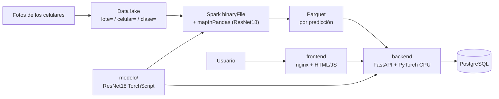

# Madurez del limón sutil · Grupo 3

Proyecto de Percepción Computacional (ISIA-111, UPAO). Clasifica fotos de limón sutil (*Citrus aurantifolia*)
en **verde**, **pintón** o **maduro** según el porcentaje de cáscara amarilla
(menos de 10 %, de 10 a 30 % y más de 30 %; NTP 011.006 y criterio del equipo). No detecta defectos ni otras especies.

## Arquitectura



Todo corre en contenedores Docker. El modelo se entrenó en Google Colab (GPU T4) y la inferencia corre en CPU.

## Estructura del repositorio

```
percepcion-limones/
├── README.md                     este archivo
├── docker-compose.yml            frontend + backend + base de datos
├── .env.ejemplo                  usuario y clave de PostgreSQL para uso local (copiar a .env)
├── notebooks/                    entrenamiento y evaluación (secciones 4 a 6)
├── modelo/                       modelo_info.json, preprocesamiento.py (el .pt va en la Release modelo-v1)
├── pipeline/                     sección 7: pipeline batch en Spark (Docker)
├── servicio/                     sección 8: API (backend), página web (frontend) y base de datos
│   ├── backend/
│   ├── frontend/
│   └── db/
├── pruebas/                      evidencias de la sección 8.1 (latencia, fotos nuevas)
├── resultados_spark/             resultados reales de Spark (los sube Franco desde su PC)
├── resultados_servicio/          resultados reales del servicio (latencia, fotos nuevas)
├── GUIA_MODELO_COLAB_A_PC.md     guía paso a paso usada en la PC
└── CLAUDE.md                     guía de trabajo del equipo
```

Las fotos **no** están en el repositorio (ver los enlaces de Drive en `CLAUDE.md`).

## Cómo correrlo (Windows, PowerShell, Docker Desktop)

```powershell
git clone https://github.com/ByArk3/percepcion-limones.git
cd percepcion-limones
Invoke-WebRequest -Uri https://github.com/ByArk3/percepcion-limones/releases/download/modelo-v1/resnet18_limon.pt -OutFile modelo\resnet18_limon.pt
Get-FileHash modelo\resnet18_limon.pt -Algorithm SHA256
```

El SHA-256 tiene que ser `8eec3d12ef05ec3286157fe2f8174f82b3b2d4ca237348b3576658e77dbf62ef`.

| Qué | Cómo | Detalle |
|---|---|---|
| Página web + API + base de datos | `copy .env.ejemplo .env` y `docker compose up -d --build`, luego abrir http://localhost:8080 | `servicio/README.md` |
| Pipeline de Spark (lotes) | `powershell -ExecutionPolicy Bypass -File .\pipeline\correr_todo.ps1` | `pipeline/README.md` |
| Entrenamiento | `notebooks/Grupo3_limones_drive_Colab.ipynb` en Colab (GPU T4) | corrida con salidas: `notebooks/Grupo3_limones_drive_Colab_ejecutado_16nov.ipynb` |

## Estado

| Parte | Sección | Estado |
|---|---|---|
| Entrenamiento y evaluación (Colab, 16-nov) | 4 a 6 | Hecho |
| Pipeline de Spark en Docker | 7 | Código listo; mediciones reales en la PC en curso |
| Servicio (web + API + PostgreSQL) | 8.1 | Código listo; latencia real pendiente en la PC |
| MLflow: comparación y registro | 8.2, 8.3 | Pendiente |
| Reproducibilidad (este README completo) | 8.4, 11 | Pendiente |
