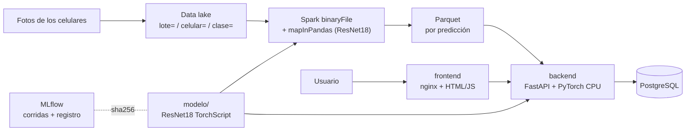

# Madurez del limón sutil · Grupo 3

Proyecto de Percepción Computacional (ISIA-111, UPAO, 2026-II). Clasifica fotos de limón sutil (*Citrus aurantifolia*)
en **verde**, **pintón** o **maduro** según el porcentaje de cáscara amarilla (verde < 10 %, pintón 10-30 %,
maduro > 30 %; NTP 011.006 y criterio del equipo). Solo limón sutil; no detecta defectos ni otras especies.

## Arquitectura



Todo corre en contenedores Docker. El modelo se entrenó en Google Colab (GPU Tesla T4) y la inferencia corre en CPU.

## Estructura del repositorio

```
percepcion-limones/
├── README.md                       este archivo
├── requirements.txt                versiones exactas de la corrida final (Colab, 16-nov-2026)
├── docker-compose.yml              servicio: frontend + backend + PostgreSQL
├── .env.ejemplo                    clave local de PostgreSQL (copiar a .env; el .env no se sube)
├── data/README.md                  cómo obtener las fotos (no están en el repositorio)
├── notebooks/                      entrenamiento y evaluación (secciones 4 a 6) + corrida con salidas del 16-nov
├── src/                            el mismo proceso del notebook como scripts
│   ├── comun.py, metricas.py       parámetros acordados (semillas, metas, umbral H < 27) y métricas
│   ├── datos/                      inventario y duplicados, limpieza, partición 70/15/15
│   ├── modelos/                    ResNet18 (layer4 + fc), Dataset y predicción
│   ├── entrenar.py, evaluar.py     entrenamiento (3 semillas) y evaluación sobre la prueba
│   ├── perfilar_entrenamiento.py   sección 5.5: carga de lotes vs cómputo
│   ├── registrar_modelo.py         secciones 8.2 y 8.3: tags y Model Registry de MLflow
│   └── huella.py                   sección 9.2: energía y CO2
├── modelo/                         modelo_info.json, preprocesamiento.py (el .pt va en la Release modelo-v1)
├── pipeline/                       sección 7: pipeline batch en Spark (Docker)
├── servicio/                       sección 8.1: backend (API), frontend (web) y base de datos
├── pruebas/                        evidencias de 8.1: latencia (mediana y p95) y fotos nuevas
├── resultados_spark/               resultados reales de Spark (PC, 16-nov)
├── resultados_servicio/            resultados reales del servicio (PENDIENTE)
├── resultados_mlflow/              resumen del registro del modelo (PENDIENTE)
├── resultados_perfil/              perfil del entrenamiento (PENDIENTE)
├── docs/resultados_para_informe.md todas las cifras reales y cómo interpretarlas
├── docs/pendientes.md              lo que falta, con los comandos exactos
└── CLAUDE.md                       guía de trabajo del equipo
```

## Inicio rápido (Windows, PowerShell, Docker Desktop)

```powershell
git clone https://github.com/ByArk3/percepcion-limones.git
cd percepcion-limones
Invoke-WebRequest -Uri https://github.com/ByArk3/percepcion-limones/releases/download/modelo-v1/resnet18_limon.pt -OutFile modelo\resnet18_limon.pt
Get-FileHash modelo\resnet18_limon.pt -Algorithm SHA256
```

El SHA-256 tiene que ser `8eec3d12ef05ec3286157fe2f8174f82b3b2d4ca237348b3576658e77dbf62ef`.

| Qué | Comando | Detalle |
|---|---|---|
| Página web + API + base de datos | `copy .env.ejemplo .env` y `docker compose up -d --build`; abrir http://localhost:8080 | `servicio/README.md` |
| Pipeline de Spark (lotes) | `powershell -ExecutionPolicy Bypass -File .\pipeline\correr_todo.ps1` | `pipeline/README.md` |
| Entrenamiento (notebook) | `notebooks/Grupo3_limones_drive_Colab.ipynb` en Colab con GPU T4, "Ejecutar todas" | resultados en `resultados.zip` |
| Entrenamiento (scripts) | `python -m src.entrenar --fotos <carpeta de fotos>` | ver "Reproducibilidad" |

## Reproducibilidad (sección 8.4)

### Semillas y partición

- Partición 70/15/15 estratificada por clase, `random_state=42` (`src/datos/particion.py`, celda 6.1 del notebook).
- Entrenamiento con 3 semillas: 42, 7 y 123 (`fijar_semilla` fija `random`, NumPy y PyTorch, incluida CUDA).
  El modelo desplegado es el de la semilla 42 (mejor época según F1 macro de validación).
- Spark y la API no tienen azar: dan las mismas probabilidades para la misma foto (diferencias menores a 1e-6).

### Versiones

| Etapa | Versiones exactas |
|---|---|
| Entrenamiento | `requirements.txt` (Python 3.13.16, PyTorch 2.14.1+cu130, torchvision 0.29.1, Colab, GPU T4) |
| Spark | `pipeline/requirements.txt` + `pipeline/Dockerfile` (Python 3.11.18, OpenJDK 17, PySpark 4.0.1, PyTorch 2.15.0+cpu) |
| Servicio | `servicio/backend/requirements.txt` + Dockerfiles (FastAPI 0.163.1, PostgreSQL 17.6, nginx 1.28.0) |

### Comandos para reproducir el entrenamiento y la evaluación

Con las fotos descargadas (ver `data/README.md`) y desde la raíz del repositorio:

```powershell
python -m venv .venv
.venv\Scripts\activate
pip install torch==2.14.1 torchvision==0.29.1 --index-url https://download.pytorch.org/whl/cpu   # solo si no hay GPU
pip install -r requirements.txt
python -m src.entrenar --fotos D:\Proyectos\percepcion-limones\dataset_limon_sutil\etiquetado_final_agregarfotos --salida resultados_src
python -m src.evaluar  --fotos D:\Proyectos\percepcion-limones\dataset_limon_sutil\etiquetado_final_agregarfotos --modelo modelo --salida resultados_src
```

- `src.entrenar` repite el proceso del notebook: limpieza, partición, ResNet18, 30 épocas y 3 semillas. Deja las tablas
  en `resultados_src/tablas/`, el modelo en `resultados_src/modelo/` (nunca sobrescribe `modelo/`) y las corridas en
  `resultados_src/mlflow.db`. En CPU tarda bastante más que en Colab. Para una prueba rápida, agregar `--epocas 2 --semillas 42`.
- `src.evaluar` evalúa el modelo publicado (`modelo/`) sobre la misma partición de prueba (35 fotos).
- **Las cifras del informe salen de la corrida del notebook del 16-nov** (`notebooks/Grupo3_limones_drive_Colab_ejecutado_16nov.ipynb`).
  Los scripts sirven para que un tercero repita el proceso; su resultado puede variar un poco (ver abajo).

### Fuentes de no determinismo (medidas, no supuestas)

| Fuente | Evidencia real | Impacto |
|---|---|---|
| Operaciones de cuDNN no deterministas en GPU y orden de lectura de archivos | Mismo código y misma GPU T4: 13-nov vs 16-nov. Recall Maduro de la semilla 42 pasó de 14/14 a 13/14; el baseline HOG+SVM pasó de F1 0.680 a 0.703. Entre ambas solo se renombraron fotos de Franco | ± 1 foto de prueba (1 foto = 2.9 puntos de exactitud con 35 fotos) |
| CPU vs GPU | 04-nov en la PC (CPU, 204 fotos) F1 0.909 ± 0.025 vs Colab 21-oct (GPU) 0.879 ± 0.058, con la misma semilla | dentro de la variación entre semillas |
| Pocas fotos de prueba | 35 fotos; intervalo de Wilson del recall Maduro (semilla 42): 13/14 = 0.929 [0.69, 0.99] | las diferencias menores a ~3 puntos no son concluyentes |

## Estado

| Parte | Sección | Estado |
|---|---|---|
| Entrenamiento y evaluación (Colab, 16-nov) | 4 a 6 | Hecho |
| Escalamiento del entrenamiento | 5.5 | Código listo (`src/perfilar_entrenamiento.py`); falta correrlo |
| Pipeline de Spark en Docker | 7 | Hecho en la PC el 16-nov |
| Servicio (web + API + PostgreSQL) | 8.1 | Funcionando en la PC; faltan latencia, `curl`, tamaños y fotos nuevas |
| MLflow: comparación y registro | 8.2, 8.3 | Código listo y probado con el `mlflow.db` real (`src/registrar_modelo.py`); falta correrlo en la PC |
| Reproducibilidad | 8.4, 11 | Este README; falta probarlo desde un clon limpio en la PC |
| Huella computacional | 9.2 | Calculada con tiempos reales (`src/huella.py`); falta el tiempo de la API |

Lo que falta, con los comandos exactos: `docs/pendientes.md`.
