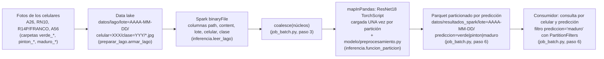

# Pipeline batch en Spark (Tarea A · sección 7 del informe)

Clasifica todas las fotos de un lote con la ResNet18 exportada y guarda el resultado en Parquet.
Corre en Docker porque Spark 4.0 necesita Java 17 o 21 y la PC tiene Java 23.

| Archivo | Qué hace |
|---|---|
| `Dockerfile` | `python:3.11.18-slim-bookworm` + `openjdk-17-jre-headless` + librerías con versión exacta |
| `requirements.txt` | Versiones exactas; PyTorch y torchvision **CPU** desde `download.pytorch.org` |
| `preparar_lago.py` | Copia las fotos a `datos/lago/lote=AAAA-MM-DD/celular=XXX/clase=YYY/` |
| `inferencia.py` | Código común: sesión de Spark, clasificador, función de partición, bucle secuencial, bitácora |
| `job_batch.py` | Pasos 1 a 6: lago, binaryFile, particiones, inferencia, coherencia, Parquet y consulta |
| `medir_escalabilidad.py` | Paso 7 y 8: speedup, volumen (H2), punto de cruce, Parquet vs CSV y MLflow |

La imagen **no** lleva fotos, modelo ni código: se montan con `-v` al correr.

## 1. Antes de empezar (solo la primera vez)

En la carpeta `modelo\` del repositorio tienen que estar:

- `modelo_info.json` y `preprocesamiento.py` (vienen en el repositorio; revisar que diga `"epocas": 30`)
- `resnet18_limon.pt` (se descarga de la Release `modelo-v1`, no está en el código)

```powershell
cd D:\Proyectos\percepcion-limones\repo
git pull
Invoke-WebRequest -Uri https://github.com/ByArk3/percepcion-limones/releases/download/modelo-v1/resnet18_limon.pt -OutFile modelo\resnet18_limon.pt
Get-FileHash modelo\resnet18_limon.pt -Algorithm SHA256
```

El SHA-256 tiene que ser igual al campo `sha256` de `modelo\modelo_info.json` (el job también lo revisa y lo escribe en la bitácora).

## 2. Construir la imagen

```powershell
cd D:\Proyectos\percepcion-limones\repo
docker build -t limon-spark:1.0 -f pipeline/Dockerfile .
docker images limon-spark:1.0
```

Anotar el tamaño de la imagen que muestra el segundo comando.

## 3. Correr el job batch (pasos 1 a 6)

```powershell
cd D:\Proyectos\percepcion-limones\repo
docker run --rm `
  -v "D:\Proyectos\percepcion-limones\dataset_limon_sutil\etiquetado_final_agregarfotos:/datos/fotos:ro" `
  -v "${PWD}:/repo" -v limon-datos:/repo/datos -w /repo `
  limon-spark:1.0 python pipeline/job_batch.py --fotos /datos/fotos --modelo modelo --salida resultados_spark
```

- Las fotos se montan en **solo lectura** (`:ro`).
- `limon-datos` es un volumen de Docker para `datos/` (lago y Parquet). Es más rápido que escribir en el disco de Windows y se mantiene entre el paso 3 y el 4. Nada de `datos/` se sube a GitHub.
- Todo lo que hay que subir queda en `resultados_spark/`.

## 4. Correr las mediciones (paso 7 y 8)

Usa el lago y el Parquet del paso 3, en una sola sesión de Spark. Con unas 200 fotos y 2 a 4 núcleos puede tardar entre 15 y 40 minutos (procesa unas 8,000 fotos en total).

```powershell
docker run --rm `
  -v "${PWD}:/repo" -v limon-datos:/repo/datos -w /repo `
  limon-spark:1.0 python pipeline/medir_escalabilidad.py --modelo modelo --salida resultados_spark
```

Opcional:
- `--con-5000` agrega el volumen de 5,000 fotos (tarda bastante más).
- Para registrar en el mismo `mlflow.db` del notebook, agregar `-v "D:\Proyectos\percepcion-limones\resultados:/resultados"` y `--mlflow sqlite:////resultados/mlflow.db`. Sin esto se crea `resultados_spark/mlflow.db` (no se sube).

## 5. Datos de la PC y subir los resultados

```powershell
docker info --format "CPUs={{.NCPU}} Memoria={{.MemTotal}}"
Get-CimInstance Win32_Processor | Select-Object Name, NumberOfCores, NumberOfLogicalProcessors
git add resultados_spark
git commit -m "Resultados reales de Spark (lote 2026-11-04)"
git push
```

Pegar en el chat la salida de los dos primeros comandos. Los núcleos que usa Spark salen de `os.cpu_count()` dentro del contenedor y quedan en la bitácora.

## 6. Qué se genera en `resultados_spark/`

| Archivo | Para el informe |
|---|---|
| `log_job_batch.txt`, `log_medir_escalabilidad.txt` | Bitácoras completas: fecha, versiones, núcleos, sha256 y todas las mediciones |
| `tablas/spark_conteo_celular_clase.csv`, `tablas/lago_*.csv` | Fotos por celular y clase; fotos ignoradas y por qué (7.3) |
| `tablas/spark_particiones.csv` | Sin ajustar vs `coalesce(núcleos)`: particiones, veces que se cargó el modelo, tiempo (7.3) |
| `tablas/spark_coherencia.csv` | Diferencia máxima Spark vs secuencial (< 1e-5) |
| `tablas/spark_predicciones.csv`, `tablas/spark_consulta_celular_prediccion.csv` | Salida del job y consulta del consumidor |
| `plan_partition_filters.txt` | Plan con `PartitionFilters` al filtrar `prediccion = 'maduro'` (7.3) |
| `tablas/spark_speedup.csv`, `figuras/spark_speedup.png` | Speedup con fila secuencial, ideal y línea de núcleos (7.4) |
| `tablas/spark_volumen.csv`, `figuras/spark_volumen.png` | ms por foto con 100, 500 y 1,000 fotos; criterio H2 (7.4) |
| `tablas/spark_cruce.csv`, `figuras/spark_cruce.png` | Secuencial vs Spark y punto de cruce estimado (7.4) |
| `tablas/parquet_vs_csv.csv` | Tamaño en disco y tiempo de leer 1 columna (7.3) |

## 7. Diagrama del sistema (sección 7.2)

Cada caja es una parte del código (entre paréntesis, dónde está).



## 8. Cómo se mide (para explicarlo en el informe)

- Siempre con `toPandas()`/`collect()` o con la escritura, **nunca con `count()`** (Spark quitaría la UDF del plan).
- PyTorch y OpenCV usan **1 hilo por tarea** (`--hilos-torch 1`), también en el bucle secuencial. Así el paralelismo viene solo de las particiones de Spark y el speedup se puede comparar con mín(k, núcleos).
- Speedup = tiempo del bucle secuencial / tiempo de Spark. Los tiempos incluyen la carga del modelo (una vez en el secuencial, una vez por partición en Spark).
- Antes de medir se hace un calentamiento que no se cuenta (arranque de los procesos de Python de Spark). En el paso 3 las dos configuraciones se miden dos veces, alternadas, y se toma la menor: en la prueba, la primera corrida salía casi el doble de lenta solo por ir primera.
- Para llegar a 1,000 fotos se repiten las rutas. En las mediciones del paso 7 la lista de fotos sale de binaryFile y la función de partición lee los bytes desde la ruta. Así `repartition(k)` solo reparte rutas y no copia megabytes de imágenes entre particiones. En el job (paso 4) se usan los bytes de la columna `content`.
- Si binaryFile ya crea menos particiones que núcleos, `coalesce` no cambia nada y la bitácora lo dice.

## 9. Qué se probó en la nube (no son cifras del informe)

El código se probó en la sesión de Claude Code con **38 fotos sintéticas** (elipses de colores) y un ResNet18 con **pesos al azar**, solo para ver que corre de punta a punta:

- Las librerías de `requirements.txt` se instalaron en `python:3.11.18-slim-bookworm` sin errores (imagen de 1.05 GB sin Java).
- `job_batch.py` y `medir_escalabilidad.py` corrieron completos. Coherencia Spark vs secuencial: 1.2e-07 (< 1e-5). Aparece `PartitionFilters` en el plan. Se generaron las tablas, las figuras y el registro en MLflow.
- **No se pudo probar** el paso `apt-get install openjdk-17-jre-headless` del Dockerfile, porque la red de la sesión no deja entrar a `deb.debian.org`. Los scripts se corrieron con Java 21 fuera del contenedor. El primer `docker build` en la PC es la prueba real de ese paso.

Todas las cifras del informe salen de la corrida en la PC de Franco.
