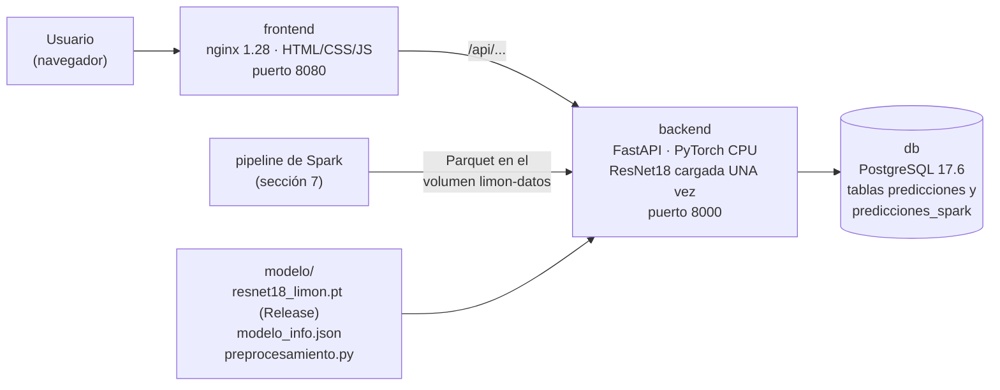

# Servicio de inferencia (sección 8 del informe)

Página web + API + base de datos, cada una en su contenedor Docker, levantadas con `docker compose`.



| Contenedor | Imagen | Lenguaje | Qué hace |
|---|---|---|---|
| `frontend` | `nginx:1.28.0-alpine` | HTML, CSS, JavaScript (sin frameworks) | Página web: subir foto o zip, historial, lotes de Spark, datos del modelo |
| `backend` | `python:3.11.18-slim-bookworm` | Python (FastAPI, PyTorch CPU) | API: clasifica con la ResNet18 y guarda cada predicción |
| `db` | `postgres:17.6-alpine` | SQL | Historial de predicciones y resultados de los lotes de Spark |

| Carpeta | Contenido |
|---|---|
| `backend/app/main.py` | Endpoints de la API |
| `backend/app/modelo.py` | Carga del modelo una sola vez; usa la clase `Clasificador` de `pipeline/inferencia.py` (la misma que Spark) |
| `backend/app/base_datos.py` | Guardar y consultar en PostgreSQL; cargar el Parquet de Spark |
| `backend/Dockerfile`, `backend/requirements.txt` | Imagen del backend, versiones exactas, PyTorch **CPU**, sin TensorFlow, con `HEALTHCHECK` |
| `frontend/web/` | `index.html`, `app.js`, `estilos.css` |
| `frontend/nginx.conf` | Sirve la web y manda `/api/...` al backend |
| `db/init.sql` | Tablas `predicciones` y `predicciones_spark` |
| `../docker-compose.yml` | Une los 3 contenedores (raíz del repositorio) |
| `../pruebas/` | `medir_latencia.py`, `prueba_fotos_nuevas.py` |

## API

| Método y ruta | Recibe | Devuelve |
|---|---|---|
| `GET /health` | — | `{"estado": "ok", "version_modelo", "sha256", ...}` |
| `GET /modelo` | — | Datos de `modelo_info.json` (métricas de prueba de la semilla 42, fotos, épocas...) |
| `POST /predict` | foto en `multipart/form-data`, campo `archivo` | `{"clase", "probabilidades", "version_modelo", "sha256", "latencia_ms"}` |
| `POST /predict_lote` | `.zip` con fotos (máximo 300 fotos o 200 MB), campo `archivo` | conteo por clase y una fila por foto |
| `GET /historial?limite=50` | — | últimas predicciones guardadas y conteo por clase |
| `POST /lotes/sincronizar` | — | copia a PostgreSQL el Parquet de cada `lote=...` que dejó Spark |
| `GET /lotes` | — | fotos por lote, celular y predicción |

Documentación automática de FastAPI: http://localhost:8000/docs

**Trazabilidad (8.3):** cada fila de `predicciones` guarda el `sha256` del modelo que hizo la predicción.
La foto no se guarda; solo su huella MD5.

## Cómo correrlo (PowerShell, en la carpeta del repositorio)

Requisito: `modelo\resnet18_limon.pt` descargado de la Release `modelo-v1` (ver `modelo/README.md`).

```powershell
cd D:\Proyectos\percepcion-limones\repo
git pull
copy .env.ejemplo .env
docker compose up -d --build
docker compose ps
```

La primera vez el `--build` tarda varios minutos (baja PyTorch CPU). Cuando los 3 contenedores digan `healthy`,
abrir **http://localhost:8080**.

Apagar (el historial se queda en el volumen `limon-pg`):

```powershell
docker compose down
```

## Evidencias para el informe (8.1)

Guardar las salidas en `resultados_servicio/` y subirlas a GitHub.

**1. Tamaño de las imágenes**

```powershell
docker images limon-backend:1.0
docker images limon-frontend:1.0
docker images postgres:17.6-alpine
```

**2. `curl` de ejemplo** (`curl.exe` viene con Windows 10/11)

```powershell
curl.exe http://localhost:8000/health
curl.exe -F "archivo=@D:\ruta\de\una\foto.jpg" http://localhost:8000/predict
```

**3. Latencia en el contenedor** (200 llamadas con fotos reales; mediana y p95)

```powershell
docker compose run --rm `
  -v "D:\Proyectos\percepcion-limones\dataset_limon_sutil\etiquetado_final_agregarfotos:/fotos:ro" `
  backend python /pruebas/medir_latencia.py --url http://backend:8000 --fotos /fotos --llamadas 200
```

Deja `resultados_servicio/latencia.csv` y `resultados_servicio/latencia_resumen.txt`.
Reporta dos tiempos: ida y vuelta (lo que siente el usuario) y lo que tarda el backend (preprocesamiento + modelo).
Las fotos que la API no puede leer se anotan y no se cuentan.

**4. Fotos nuevas** (6 fotos que NO estén en el dataset, 2 por clase; nombres `v_...`, `p_...`, `m_...`)

```powershell
docker compose run --rm `
  -v "D:\Proyectos\percepcion-limones\fotos_nuevas:/fotos_nuevas:ro" `
  backend python /pruebas/prueba_fotos_nuevas.py --url http://backend:8000 --fotos /fotos_nuevas
```

Imprime las probabilidades con 4 decimales de la API y del script directo (mismo modelo y misma clase `Clasificador`)
y deja `resultados_servicio/fotos_nuevas.txt`.

**5. Lotes de Spark en la web**

Después de correr el job de Spark (`pipeline/README.md`), en la pestaña **Lotes de Spark** pulsar
**Cargar resultados de Spark**. El backend lee el Parquet del volumen `limon-datos` y lo copia a PostgreSQL.

## Qué se probó en la nube (no son cifras del informe)

En la sesión de Claude Code se construyeron las imágenes y se levantaron los 3 contenedores con
`docker compose`, con el modelo real (`sha256 8eec3d12...`) y fotos sintéticas:

- `/health`, `/modelo`, `/predict`, `/predict_lote`, `/historial`, `/lotes/sincronizar` y `/lotes` respondieron bien,
  directo y a través de nginx; una imagen dañada devuelve error 422.
- Para la misma foto, la API dio las mismas probabilidades que el job de Spark.
- `prueba_fotos_nuevas.py`: diferencia máxima API vs script de 4.6e-07.
- `medir_latencia.py` y la página web (con Playwright) funcionaron sin errores.

Las cifras de latencia y tamaño del informe salen de la PC de Franco.
